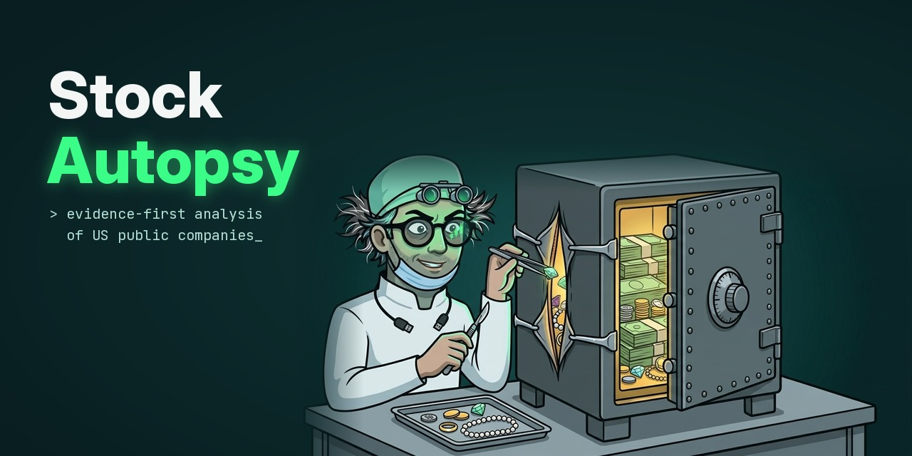

# Stock Autopsy

<p align="center">
  
</p>

Analyzes one US public company from several independent perspectives (business
model, forensic accounting, valuation, pre-mortem) and reconciles them in an
"Investment Committee" synthesis that looks for productive conflicts instead of
averaging opinions.

Part of the Autopsy series: [Startup Autopsy](https://github.com/AKulikou/startup-autopsy)

**Not investment advice.** Stock Autopsy is a research-structuring and learning tool.
It never says buy, sell or hold; its verdicts describe how strong the evidence is.

> Status: Phase 1 works end to end (data layer, four evaluators, committee, number
> check, eval on five golden companies, a local web page). Not published as a product;
> see the honest limits below.

## Example

Abridged from a real run on Coca-Cola, one of the five golden companies (data as of
2026-10-21, price of 2026-10-20):

> ## Verdict: Weak case: the evidence does not support the investment thesis
>
> Confidence: medium.
>
> The return math is clear and holds across reasonable choices, but the cash-flow and
> margin swings are unexplained and the latest quarter and peer data are missing.
>
> **The research case is weak: Coca-Cola is a strong business, but the current price
> leaves only about 4.9% a year if growth stays close to its recent pace.**
>
> **For:**
> - The business keeps a large share of each sale, with profit margins that have stayed
>   high for ten years.
> - Filings have been on time, with no sign of accounting restatements for errors, and
>   debts are comfortably covered by profit.
>
> **Against:**
> - At today's price, a buyer would earn only about 4.9% a year if growth stays near
>   recent levels, and even the optimistic case values the shares below the price.
> - In 2024 and 2025 the cash the business produced was well below its reported profit,
>   and dividends were more than the cash left after spending, with no explanation in
>   the data.
>
> **What the price assumes:** At today's price of $93.49, if the base case comes true
> (revenue growth slowing from 4% to 3% a year and an operating margin of 28% over five
> years), a buyer earns about 4.9% a year.
>
> […]
>
> ## Number check
>
> 34 claims that quote the data were checked against it by code. 28: every number
> matches the cited data; 5: no number to check; 1: some numbers are not in the cited
> data.
>
> | Evaluator | Statement | Basis | Problem |
> |---|---|---|---|
> | Valuation Analyst | A 1-point change in the discount rate moves the base value by up to $12.01 per share, the largest of the four sensitivities. | valuation math › sensitivities › item 1 › largest change per share | some numbers are not in the cited data: 0.01 |
>
> **Calculated claims:** 20 of 25 could be reproduced by code from the data they cite.
>
> | Evaluator | Statement | Not reproduced |
> |---|---|---|
> | Pre-Mortem Analyst | A 50% price fall at unchanged trailing earnings would imply a price-to-earnings ratio of about 14.7. | 0.5 |

The four analysts did not agree: the business model was rated strong, the accounting
and the pre-mortem adequate, the valuation weak. The committee did not average them. It
found that nobody disputed the quality of the business, only the price, and let the
price carry the verdict. In the number check, $12.01 and 14.7 match the data; the check
lists the step and the factor it could not tie to the data, and leaves the judgement to
the reader instead of hiding them.

## The idea: data first, model second

Language models produce plausible numbers from memory, and a plausible but wrong
revenue or share count silently breaks an analysis. Here the model never supplies
numbers:

```
1. Stock Autopsy's code fetches official data (SEC EDGAR) and prices → one DATA PACK (as_of dates, sources, data quality)
2. Every evaluator gets the byte-identical pack → analyzes, tags every claim
3. Stock Autopsy does the math in code, not the AI: multiples, growth rates, DCF
4. The synthesis reads all evaluator reports → verdict, conflicts, monitoring plan, next research steps
5. Stock Autopsy's code checks every number the model quotes as data against the pack
```

Every claim is tagged as data (with the pack path it comes from), derived, an
assumption or unverified, and a missing figure is reported as unknown — never as
zero. The full specification (evaluator prompts, DATA PACK schema, data quality
rules) is in [docs/stock_autopsy_prompts.md](docs/stock_autopsy_prompts.md); where
the code deviates from it, that document says so.

The committee's verdict is one of: strong case, conditional case, insufficient data,
weak case, red-flagged.

## What works

| Part | What it does |
|------|--------------|
| Data layer | SEC company facts, filing history and 8-K items, extension concepts from filing XBRL where needed, prices via yfinance; daily cache; ten fiscal years, discrete quarters, trailing twelve months; restatements and late filings detected; every missing value carries a reason |
| Evaluators | Business Model, Forensic (accounting warning signs, restatements), Valuation (the model proposes DCF assumptions, Stock Autopsy calculates bear / base / bull in code, reverse DCF, the yearly return a buyer at today's price gets if the base case comes true, and sensitivities; the model interprets what the price assumes), Pre-Mortem |
| Committee | One call that reads the evaluators, names the conflicts and decides the verdict, with a headline and three reasons for and against in plain words; code lowers its confidence when too much rests on unverified claims or a perspective is missing |
| Number check | Every number in a data claim is compared with the pack value at the path the claim cites (with its sign where the wording states one); calculated claims, numbers in prose and unknowns stated as zero are checked too |
| Reports | `report.md` in plain words (no codes, tickers or field names), `report.json` with the codes, the exact pack and its provenance |
| Eval | Five golden companies with labels written before any run, a judge for "must find" / "must not say" statements (majority of three votes, verbatim evidence), constant-answer baselines, stability between reps, and a free regrade of stored runs when a check changes |

## Quick start

```bash
python -m venv venv && venv\Scripts\activate   # Windows
pip install -r requirements-dev.txt
copy .env.example .env                          # then set ANTHROPIC_API_KEY and SEC_USER_AGENT
pytest && ruff check .                          # no network, no API calls
python -m datalayer.pack KO                     # build the data pack only (free, no model)
python main.py KO                               # full analysis (paid, see below)
python -m web                                   # the same in a local web page: http://127.0.0.1:8001
```

The web page takes a company, a brand or a ticker (a name or brand is looked up with one
cheap call and checked against the SEC list), shows the data being gathered and each
analyst finishing, then the answer in plain words with what the price assumes, and every
quoted number coloured by what the number check found. A dropped progress stream is
reopened from the next event (the server also sends a heartbeat during the long silent
steps), so a lost connection is never reported as a failed run, and finished analyses can
be reopened from "Recent analyses". Design: [docs/web_ui.md](docs/web_ui.md).

A finished report can be translated on demand (Lithuanian by default; the same languages
in the same order as Startup Autopsy), on the page or with
`python -m translate results/<run> --language Lithuanian`:
one cheap call per section, and a section whose numbers do not come back with the same value
and scale stays in English. A glossary per language fixes the terms (Russian, and a Lithuanian
draft that a fluent reader still has to review). report.md and every copy end with a collapsed
glossary of the terms that report uses, inserted by code and never translated by the model. The
English report remains the source of truth.

Only companies that file 10-K and 10-Q reports can be analyzed. Foreign companies filing
Form 20-F or 40-F are not read today, whatever their accounting standard, and neither are
funds; the page says so when it shows such a company, and a run stops before any paid call
when the data pack holds no annual statements.

SEC EDGAR asks every client to declare a `User-Agent` with a contact email and to
stay under 10 requests per second; set `SEC_USER_AGENT` in `.env`.

**Cost and time.** A full run makes six Claude calls (Sonnet 5.5 at its default
effort) and costs about 0.60 USD and three minutes (measured on Kraft Heinz,
2026-10-15; later runs on the page cost 0.58-0.67 USD). Each analyst writes its own
prompt-cache entry today (see `SHARED_OUTPUT_SCHEMA` under [Configuration](#configuration)).
Through the Message Batches API, as the eval runs it, an attempt costs about 0.26-0.30 USD
and takes longer.

## Configuration

Two values in `.env` are required (copy [.env.example](.env.example)):

| Variable | Purpose |
|---|---|
| `ANTHROPIC_API_KEY` | The Claude API key; the program stops at startup if it is missing or does not start with `sk-ant-` |
| `SEC_USER_AGENT` | Your name and a contact email, sent to SEC EDGAR as the `User-Agent`; without an email (or with the placeholder from `.env.example`) the data layer refuses to call the SEC, which would answer 403 |

Fixed settings in [`config.py`](config.py):

| Setting | Default | Purpose |
|---|---|---|
| `DEFAULT_MODEL` | `claude-sonnet-5-5` | Model for every analysis call |
| `MODEL_PRICING_PER_MTOK` | Sonnet, Opus and Haiku rates | Prices for the cost estimate after a run, with the date they were checked; add an entry when changing the model |
| `MAX_TOKENS` | `20000` | Output limit per call, thinking included; a truncated answer is an error. Above about 21,333 the SDK refuses a request without streaming |
| `TRANSLATION_MODEL` | `claude-haiku-5-5` | Translated copies of a report, at `low` effort, a rejected section retried once at `medium` |

**Experiments.** Five `.env` switches change what the model is asked or how; they stay
at their defaults until the eval shows a change helps (see [eval/CHANGES.md](eval/CHANGES.md)):

| Switch | Default | Effect |
|---|---|---|
| `ANALYSIS_MODEL` | unset (`claude-sonnet-5-5`) | Another model for the evaluators and the committee |
| `ANALYSIS_EFFORT` | unset (the model's own default) | `low` ... `max`: how much the model thinks and writes; the real depth control on the 5.5 models |
| `THINKING` | `off` | `adaptive` sends a thinking parameter; with `off` the 5.5 models still think adaptively, Sonnet 4.6 does not |
| `PROMPT_CACHING` | `on` | `off` stops caching the shared rules and data pack, to measure what the cache saves |
| `SHARED_OUTPUT_SCHEMA` | `off` | One output schema for all analysts instead of one each |

Why `SHARED_OUTPUT_SCHEMA` is off: the API renders the output schema as a system prompt
of its own ahead of the cached prefix, so with a schema per analyst each analyst writes
its own cache entry and none reads another's. One shared schema would let them read one
entry (an estimated 14% less per run), but the API refuses the five-analyst schema as
too large to compile (checked 2026-10-22, nothing billed). The switch stays for a
smaller variant.

## Project structure

```
main.py              CLI: one company, one full run, the report saved under results/
config.py            API key check, model, prices, token limit, experiment switches
datalayer/           SEC EDGAR and price data, daily cache, statements, data quality, the DATA PACK
evaluators/          the four analysts as data, their output schemas and validators
perspectives/        one analyst call: prompt layout for the shared cache, one structured request
valuation/           DCF for bear, base and bull, reverse DCF, implied annual return, sensitivities
synthesis/           the Investment Committee: schema, principles and validator
analysis/            run_autopsy(): pack, valuation, the other analysts in parallel, committee, number check
reporting/           number check and grounding, report.md and report.json, plain-word wording
translate/           translated copies of report.md, glossaries per language, number formats
web/                 local web page: FastAPI app, one run at a time, name-to-ticker lookup, static page
core/                Anthropic client, batching client, structured calls, token costs, parallel calls
eval/                eval cases, runner, grading, judge and the behaviour-change log (CHANGES.md)
examples/            a minimal run of two perspectives on one shared context
scripts/             golden fixture freezing, private ticker guard
tests/               unit tests with a fake Claude client, golden fixtures, page tests (tests/js)
docs/                specification, web page design, golden companies, images
```

`results/`, `logs/`, `data_cache/` and `private/` are generated or personal and git-ignored.

## Testing and its honest limits

Unit tests use a scripted fake Claude client and frozen fixtures, so they never
touch the network; the page's own logic (reconnecting a dropped stream, card states, lookup
cards, report tabs, collapsed blocks, and that every page script parses) is tested with
Node's test runner, which pytest starts when Node 22+ is installed (CI installs
it). The behaviour eval runs the real pipeline on frozen packs of
five golden companies: Coca-Cola (boring quality), Snowflake (fast-growing,
loss-making), Kraft Heinz (the 2019 restatement), Comcast (cheap and flat, where
"weak case" is a wrong answer) and Plug Power (red flags dominate). Every measurement
is logged in [eval/CHANGES.md](eval/CHANGES.md).

What the eval showed:

- Forensic found Kraft Heinz's restatement trail (restated cash flow, non-reliance
  notices, the late annual report) in every attempt and never red-flagged Coca-Cola's
  routine recasts (two reps per company on the first three companies).
- The committee said "weak case" for all three original companies, scoring exactly like
  a constant answer, so two companies were added where "weak case" is wrong. Then the
  valuation framing changed (below), Comcast's data was corrected and the two new labels
  were revised:

  | Run | Primary verdict | Primary or acceptable | Error cost (0 = primary) |
  |---|---|---|---|
  | Before the valuation change (1 rep each) | 4/5 | 5/5 | 0.20 |
  | After the valuation change (1 rep each) | 2/5 | 4/5 | 1.00 |
  | Release run (2 reps each, corrected data, revised labels) | 7/10 | 9/10 | 0.40 |
  | Release run of 2026-10-22 (2 reps each, the same cases) | 5/10 | 9/10 | 0.80 |
  | A constant "weak case" on the release attempts | 4/10 | 6/10 | 0.80 |

  In the release run Coca-Cola, Snowflake and Kraft Heinz came out weak twice, Comcast a
  conditional case twice, and Plug Power red-flagged once and weak once: the committee did
  not follow a severity-5 red flag from the Forensic analyst in one attempt and raised one
  without it in the other. That is the system's least stable call. Two reps per company
  are still a small sample. The whole gap over the constant answer comes from Comcast (2 of
  2) and Plug Power (1 of 2), the two companies the author has not labelled blind; on the
  three author-labelled companies the committee scored exactly like the constant answer. The run cost 2.67 USD through the Message Batches API.
  The release run of 2026-10-22 (2.75 USD) moved Kraft Heinz from "weak" to "conditional" in both
  attempts (acceptable, not the primary label): the price sentence now gives about 8% a year,
  which the committee reads as a case under conditions. That one case is the whole drop from
  7/10 to 5/10; with it the committee's error cost equals the constant answer's on this set.
- Valuation is judged by what the price assumes rather than by a DCF value at one
  chosen discount rate: Stock Autopsy solves, in code, the yearly return a buyer at today's price gets if
  the base case comes true. At the eval's prices that was about 5% a year for Coca-Cola
  (read as expensive), 3-4% for Snowflake, 7-8% for Kraft Heinz and 12-14% for Comcast (a
  case under conditions). The first two runs above used a Comcast data pack with a wrong
  share count, since corrected (see below); the release run used the corrected one.
- Grounding is checked by code, not trusted: a mutation test quotes the golden packs'
  real values with deliberate errors (+10%, x10, a flipped "loss"/"profit") and requires
  the number check to catch at least 90% of them. Calculated claims are reproduced from
  the formula they cite, numbers in prose without a source are listed, and a sentence
  that turns an unknown value into zero ("no debt" where the filings report none) is
  flagged. In the first eval runs: 8 and 5 wrong numbers (all partial) in about 270 data claims
  per variant, one calculation off by about 5%, and the one "no debt" sentence the judge
  also found. In the release run of 2026-10-22: 6 wrong numbers in 370 data claims, 209 of 225
  calculations reproduced, 2 unknowns read as zero. In the first release run: 7 wrong numbers in
  379 data claims, 195 of 211 calculations reproduced (198 after a regrade with the corrected calculation check of
  2026-10-17, which no longer rejects a stated constant, a part of a formula or the size of
  a difference written old - new), and one "no debt" sentence again (Snowflake).
- **The number check proves faithfulness to the data pack, not that the pack is right.**
  A quoted number "matches" when it equals the pack value it cites. Comcast's pack was
  built on a 2009 share count and a spin-off read as a stock split, which put its market
  value 21% too high; the model quoted it faithfully and every check passed. Invariant
  tests now compare each golden pack with its frozen price snapshot, and the data layer
  no longer uses stale share counts or treats corporate-action adjustments as splits.
- Labels: Coca-Cola, Snowflake and Kraft Heinz were labelled by the author. Comcast and
  Plug Power were drafted by Claude Code from the data packs under the author's
  delegation and reviewed in two independent reviews; the author has not labelled them
  blind. Plug Power is strict on purpose: only "red-flagged" counts as right, so that a
  constant "weak case" cannot pass it. Its label rests on liquidity and dilution (cash
  for about four months of burn, losses larger than revenue, a fourfold share count),
  with the 2021 accounting failures as history; the routine amendments that only add
  executive-pay and governance information are not counted as red flags. The prompts do
  not yet name liquidity as a red flag and the data pack does not compute a cash runway;
  that gap between the label and the definitions is one reason the verdict flips.

## Known limitations

- **Banks, brokers and insurers** are flagged by their SEC SIC code (banks 6021-6099, credit
  companies 6111-6199, brokers and investment advisers 6200-6282, insurers 6311-6411, from the
  SEC SIC code list) before a run, on the lookup card and in the CLI, and in the report's data
  quality section. They are still valued with the general model: their net revenues are read,
  but enterprise value, the DCF and cash-flow multiples are marked "not meaningful for a bank".
  What fits them (price to book, return on equity, capital ratios) is not implemented.
- Only companies that file 10-K and 10-Q reports are read; foreign filers on Form 20-F or 40-F
  and funds are stopped before any paid call.
- Insider transactions, peers, news and earnings call transcripts are not collected.

## Roadmap

| Phase | Scope |
|-------|-------|
| 1 — MVP | Data layer (EDGAR + prices), four evaluators, Claude-based synthesis, number check, eval (done) |
| 2 | The remaining four evaluators, DCF sensitivity grid, earnings transcript input |
| 3 | Web search for catalysts, peer comparison runs, "what changed since the last autopsy" |

## License

MIT, see [LICENSE](LICENSE).
